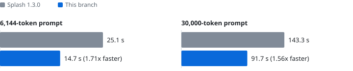
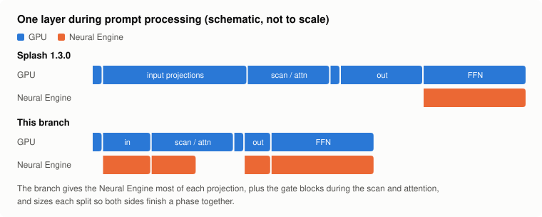
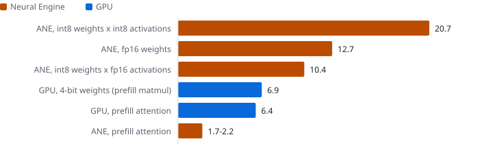
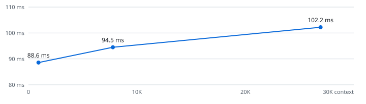
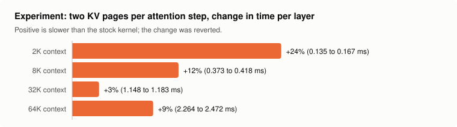

# Prompt processing on the Neural Engine and the GPU at once

Local LLMs on a Mac spend much of an agent session reading prompts: a coding
agent's first request is tens of thousands of tokens, and every tool result
after it adds thousands more. This project makes that phase 1.6-1.7x faster for
a 27B model on an M4 Pro, with the same output, by giving the Apple Neural
Engine a share of nearly every matrix multiply in the model instead of only the
feed-forward layers.

The work is a change to [Splash](https://github.com/incoai/splash), an
open-source inference engine for Apple Silicon. It lives in [`engine/`](engine),
branch `ane-prefill`: two commits on top of Splash 1.3.0.

<picture>
  <source media="(prefers-color-scheme: dark)" srcset="docs/charts/ttft-dark.svg">
  
</picture>

| Uncached prompt | Splash 1.3.0 | This branch | Speedup |
|---|---|---|---|
| 6,144 tokens | 25.08 s | 14.65 s | 1.71x |
| 30,000 tokens | 143.3 s | 91.7 s | 1.56x |

Qwen3.8-27B, MLX affine 4-bit weights, on a MacBook Pro with an M4 Pro (20-core
GPU, 16-core Neural Engine, 48 GB) running macOS 27.0.1. Each prompt is new to
the server and sized to the exact token count with its tokenizer; times are
medians. Greedy output on an 8K prompt is byte-identical to Splash 1.3.0. The
gain shrinks with length because attention, which grows quadratically and
stays on the GPU, takes more of a long prompt.

## How it works

Splash already splits each layer's feed-forward network (FFN) between the GPU
and the Neural Engine (ANE). The ANE runs its share from int8 weights that the
GPU stages a layer ahead into double-buffered IOSurfaces, and the two hand off
through a shared Metal event. The rest of each layer ran on the GPU alone while
the ANE waited.

<picture>
  <source media="(prefers-color-scheme: dark)" srcset="docs/charts/layer-dark.svg">
  
</picture>

Qwen3.8-27B interleaves 48 Gated DeltaNet (linear attention) layers with 16
full attention layers. This branch splits both mixers' projections the way the
FFN is split, by output channel:

- **Input and output projections.** The GPU computes the leading output channels
  from its 4-bit weights while the ANE computes the rest from int8 weights. A
  join kernel transposes the ANE's channel-major fp16 partial, applies each
  token's input scale in fp32, adds the residual for output projections, and
  rounds once to bf16. Input projections reuse the int8 activations the FFN
  path already rotates and packs.
- **Deferred gate blocks.** Both mixers' input projections pack an output gate
  that nothing reads until after the GDN scan or the attention. The ANE
  computes those blocks alone while the GPU runs the scan or attention, which
  was idle time for the ANE, and the gate waits for their join.
- **Staging in the FFN's shadow.** The ANE's FFN part outlasts the GPU's, so
  the GPU stages the next layer's projection weights while it waits.
- **Finer FFN shares.** The rotation block halves to 256 channels so the
  calibrated FFN share moves in smaller steps, and the rotation kernel writes
  int8 directly.

Column ranges come from the model geometry. The GPU keeps about a quarter of
each projection, a constant measured on the M4 Pro so that both sides finish a
phase together. With the split, the ANE is busy about 90% of prefill and the
GPU about 95% (Instruments, Metal System Trace with the Neural Engine track).

The ANE earns the larger share because it is about three times faster than the
GPU at the int8 matmuls it is given, and only at those:

<picture>
  <source media="(prefers-color-scheme: dark)" srcset="docs/charts/throughput-dark.svg">
  
</picture>

The second commit is a small decode fix: Apple9 GPUs held a tile boundary
measured on a 40-core M3 Max, and on the 20-core M4 Pro the register tile is
9-28% faster for multi-lane decode.

## What did not work

- **Attention on the ANE.** 1.7-2.2 trillion ops/s against 6.4 on the GPU, and
  softmax alone is a third of the ANE's time
  ([`bench/ane/ane_attention.mm`](bench/ane/ane_attention.mm)).
- **fp16 on the ANE.** It fuses int8 x int8; fp16 activations halve its
  throughput and fp16 weights cost 40%. Input segments of 2,560 channels are
  fastest ([`bench/ane/ane_projection.mm`](bench/ane/ane_projection.mm)).
- **Bigger prefill chunks.** The ANE compiler rejects 4,096-row FFN programs.
- **A smaller draft model.** Splash's DFlash2 drafter is about 1% of a decode
  step, so distilling it smaller cannot help.
- **Faster decode steps.** Each step verifies 8 drafted tokens. The weights
  alone take 69 ms to stream and the math alone 73 ms of an 81 ms step, so
  there is little overlap left to win, and verifying fewer rows loses more
  accepted tokens than it saves. Step time grows with context as attention
  reads more of the KV cache:

<picture>
  <source media="(prefers-color-scheme: dark)" srcset="docs/charts/decode-dark.svg">
  
</picture>

- **A faster long-context attention kernel.** Processing two KV pages per step
  halves the kernel's barriers, but it was 3-24% slower: the doubled
  threadgroup scratch leaves fewer threadgroups resident per core, and this
  kernel lives on latency hiding. Retuning its history splits stayed within
  noise. The patch is in [`experiments/`](experiments).

<picture>
  <source media="(prefers-color-scheme: dark)" srcset="docs/charts/attention-experiment-dark.svg">
  
</picture>

## Agent sessions: keeping the prompt cache warm

Splash caches prompt prefixes, but Claude Code sends a system message
(environment, agent and skill listings) right after the user's first message.
The user's words then come before a block that never changes, so a new
session can reuse only what precedes them. [`tools/cache_proxy.py`](tools/cache_proxy.py)
sits in front of the server and moves that message ahead of the first user
message; nothing else in a request changes, and later turns render the same
prefix. In a test session the first request reused 8,480 of its 8,492 prompt
tokens and answered in 0.5 s. Splash's SSD cache (`--max-cache-disk 10G
--persistent-cache`) keeps that prefix across server restarts.

## Reproducing

```sh
git clone --recurse-submodules https://github.com/fishy-ops/splash-ane-prefill
cd splash-ane-prefill/engine && make -j8
./splash serve --model mlx-community/Qwen3.8-27B-4bit --port 8000

# in another shell, from the repository root
python3 bench/ttft.py --tokens 6144 --reps 3
python3 bench/decode.py --contexts 1024,8192,30000
```

For the baseline, check out `1.3.0` in `engine/`, rebuild and rerun. `ttft.py`
prints each request, so the first, cold one is visible. The charts are drawn
by [`docs/make_charts.py`](docs/make_charts.py) from the numbers above.

## Limitations

- Tuned and measured on one machine. The GPU's shares are constants; a Mac with
  a different GPU-to-ANE ratio would want its own, ideally calibrated at
  startup the way the FFN share already is.
- Only the dense Qwen3.8-27B path with affine 4-bit weights splits its
  projections; other models keep upstream behavior.
- The projection splits allocate about 0.5 GB on first use, outside Splash's
  startup memory plan. While they are enabled the FFN's circuit breaker, which
  falls back to the GPU when the ANE loses time, stays off, because its
  calibration covers the FFN alone.

## License

Apache 2.0, the same as Splash, which is by Inco AI and its contributors.
